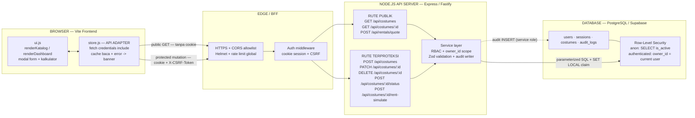
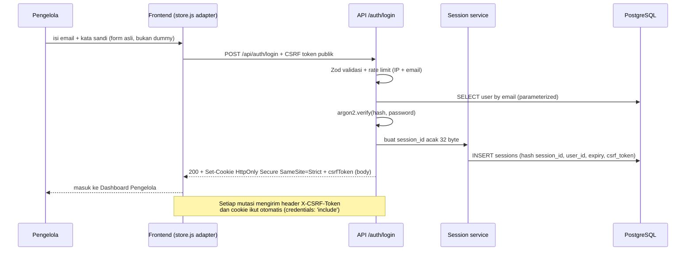
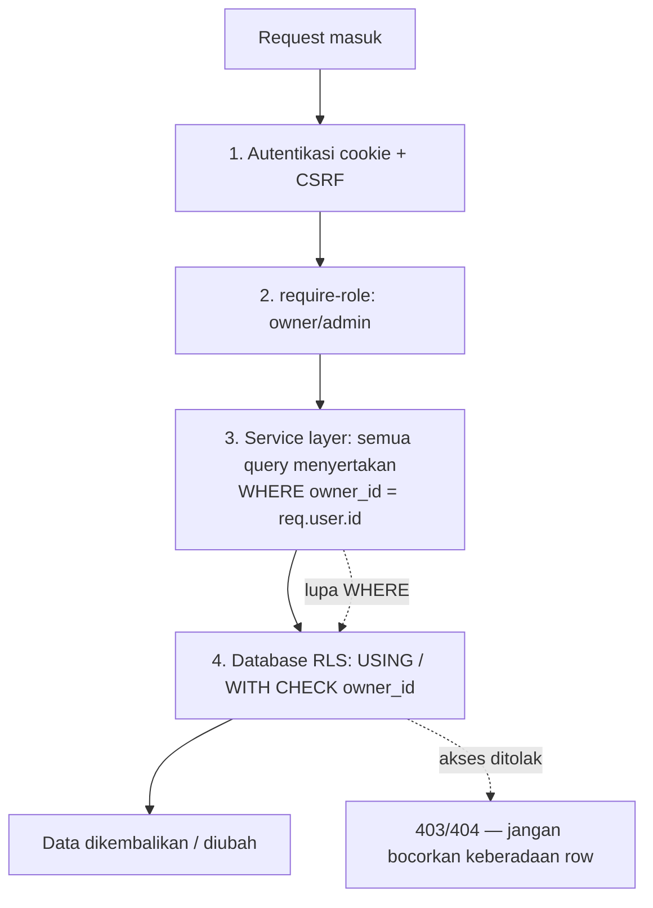
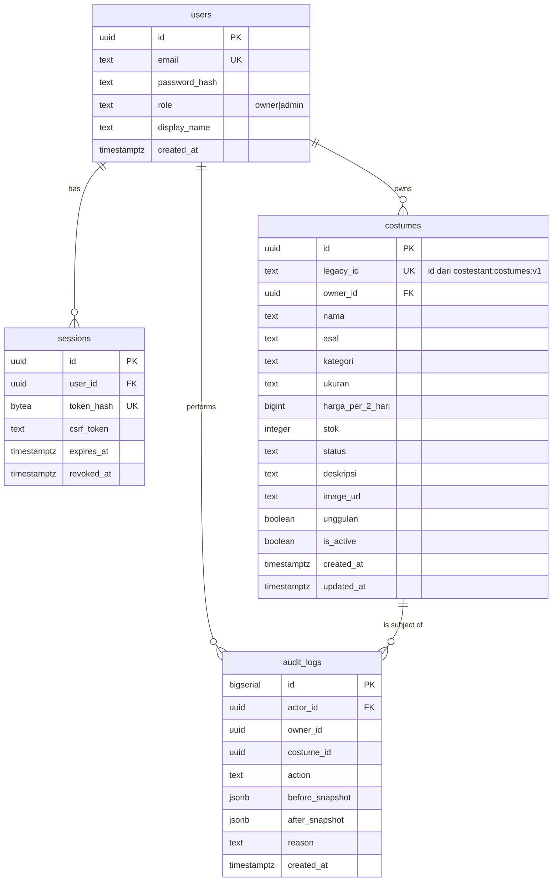
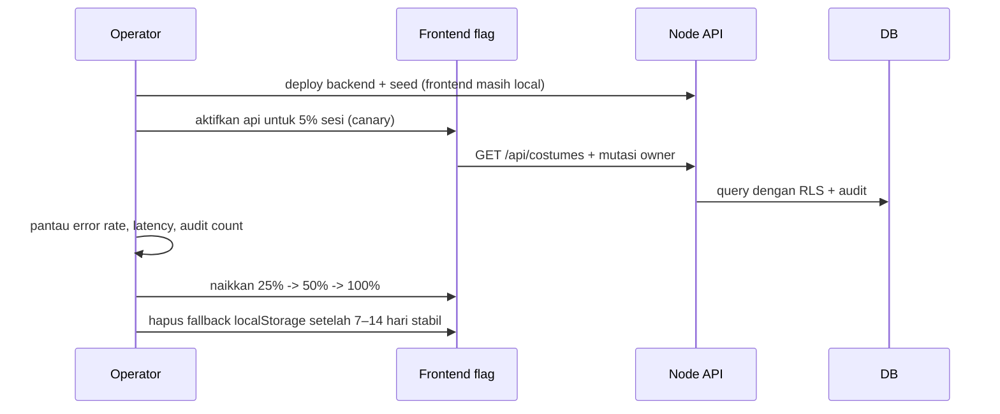

# ARCHITECTURE-MIGRATION.md — Rencana Migrasi Costestant ke Arsitektur Produksi

> **Status: DOKUMEN PERENCANAAN SAJA.**
> Dokumen ini **tidak** mengubah kode aplikasi, **tidak** membuat login palsu/form login dummy, dan **tidak** mengubah tampilan Persona 4 yang sudah ada. Semua cuplikan kode/SQL di bawah adalah **contoh rancangan target** untuk diputuskan dan diimplementasikan pada fase terpisah.
>
> Versi: `0.1` — Tanggal: `2026-11-19`
> Sumber acuan: `SPEC.md`, `UI-SPEC.md`, `TASKS.md`, dan kode saat ini (`src/products.js`, `src/store.js`, `src/ui.js`, `src/main.js`, `src/style.css`, `index.html`, `package.json`).
> Hubungan dengan dokumen lain: `SPEC.md` tetap menjadi sumber kebenaran **perilaku**; `UI-SPEC.md` untuk **tampilan**; dokumen ini hanya mengganti **tempat state berada** (localStorage → API + database).

---

## 0. Ringkasan Eksekutif

### 0.1 Kondisi aplikasi saat ini (fakta dari kode)

| Aspek | Kondisi aktual | Implikasi migrasi |
|---|---|---|
| Build tool | Vite 7, vanilla ES modules, satu `devDependencies` (`vite`) | Backend akan menjadi paket/workspace terpisah; Vite tetap dipakai untuk frontend |
| Data | `PRODUK_SEED` (8 kostum fiktif) di `src/products.js` | Seed dipakai ulang sebagai data awal database |
| Penyimpanan | `localStorage` key `costestant:costumes:v1` (+ migrasi dari `costestant.kostum.v1`) di `src/store.js` | Harus dibaca sekali oleh skrip seed, lalu tidak lagi menjadi source of truth |
| Mutasi | `addProduct`, `updateProduct`, `deleteProduct`, `resetProducts`, `simulasiSewa` → semuanya lewat `commit()` → `persist()` → `notify()` | `commit()` adalah **titik jahit** penggantian layer data (T6.3 sudah menyiapkan ini) |
| Validasi | `validateCostumeItem`, `validateCostumeList`, `validateProductDraft` di sisi klien | Harus **diduplikasi secara authoritative** di server (Zod); validasi klien tetap dipertahankan untuk UX |
| Export/Import | `exportProductsJson()` / `importProductsJson()` + tombol di toolbar dashboard | Menjadi jalur ekspor data untuk seeding database & jalur impor batch admin |
| Autentikasi | **Tidak ada** (sesuai `SPEC.md` Bagian 7) | Akan ditambahkan hanya di fase backend; klien tidak menyimpan token di `localStorage` |
| Kalkulator sewa | Fungsi murni `calculateRentalTotal`, `getRentalBreakdown`, `buildWhatsAppMessage` | Tetap di klien untuk respons instan; disarankan diekstrak ke paket domain bersama agar server bisa menghitung ulang |
| Nomor WA | `6281234567890` (placeholder, R2/NFR7) | **Tidak berubah**; tidak boleh ada kredensial/nomor asli di repositori |

### 0.2 Prinsip migrasi

1. **UI tetap, data layer yang berganti.** `renderKatalog`, `renderDashboard`, modal, toast, dan banner tidak perlu ditulis ulang. Kontrak ekspor `src/store.js` dipertahankan persis, hanya implementasinya yang mengganti `localStorage` dengan `fetch`.
2. **Server adalah source of truth.** Validasi, otorisasi, dan angka stok final ditentukan di server. Klien boleh mengoptimistik merender, tetapi harus meng-commit ulang dari respons API.
3. **Keamanan bukan opt-in.** RBAC, `owner_id`, RLS, HttpOnly cookie, CSRF, rate limit, dan audit log masuk desain sejak hari pertama backend, bukan tambahan belakangan.
4. **Zero downtime.** Backend + database disiapkan dan di-seed lebih dulu; frontend beralih lewat *feature flag*, dengan jalur rollback yang jelas.
5. **Tidak ada scope creep pada prototipe.** Dokumen ini tidak menambahkan payment gateway, WA API, notifikasi, atau fitur di luar `SPEC.md` Bagian 7 ke dalam aplikasi saat ini.

### 0.3 Target akhir (high level)

- Frontend Vite yang sama, dengan `src/store.js` sebagai **API adapter** (`fetch(..., { credentials: 'include' })`).
- Node.js (Express atau Fastify) sebagai API server + BFF (*backend-for-frontend*).
- PostgreSQL (self-hosted/managed) atau Supabase (Postgres + Auth + RLS) sebagai penyimpanan.
- Session pengelola berupa cookie `HttpOnly; Secure; SameSite=Strict`, bukan token di `localStorage`.
- Setiap perubahan inventaris tercatat di `audit_logs` dengan snapshot sebelum/sesudah.

---

## 1. Diagram Arsitektur Sistem

### 1.1 Diagram alur (Mermaid)



### 1.2 Diagram topologi ASCII

```text
                      ┌──────────────────────────────────────────────┐
                      │  BROWSER (Vite build / dev :5173)            │
                      │  ┌────────────┐   ┌────────────────────────┐ │
                      │  │  ui.js     │◄─►│ store.js (API adapter) │ │
                      │  │  Persona 4 │   │ fetch + credentials    │ │
                      │  └────────────┘   │ cache baca (opsional)  │ │
                      │                   └───────────┬────────────┘ │
                      └───────────────────────────────┼──────────────┘
                                    HTTPS             │
                     PUBLIC: GET /api/costumes        │  PROTECTED:
                     GET /api/costumes/:id            │  cookie + CSRF
                     POST /api/rentals/quote          │
                                 ┌────────────────────▼──────────────┐
                                 │  EDGE: TLS, CORS, Helmet,         │
                                 │  rate limit, session + CSRF gate │
                                 └────────────────────┬──────────────┘
                                 ┌────────────────────▼──────────────┐
                                 │  NODE API (Express / Fastify)     │
                                 │  ┌──────────────────────────────┐ │
                                 │  │ routes → service → repo      │ │
                                 │  │ Zod | RBAC | owner_id | audit │ │
                                 │  └──────────────────────────────┘ │
                                 └────────────────────┬──────────────┘
                                     parameterized SQL│ + SET LOCAL claims
                                 ┌────────────────────▼──────────────┐
                                 │  POSTGRESQL / SUPABASE            │
                                 │  users | sessions | costumes      │
                                 │  audit_logs + RLS policies        │
                                 └───────────────────────────────────┘
```

### 1.3 Pemisahan rute

| Rute | Kelas | Autentikasi | Otorisasi | Catatan |
|---|---|---|---|---|
| `GET /api/health` | Publik | Tidak | — | Health check untuk deployment |
| `GET /api/costumes` | Publik | Tidak | `anon` hanya `is_active = true` | Query: `search`, `kategori`, `ukuran`, `status`, `sortBy`, `cursor`, `limit` |
| `GET /api/costumes/:id` | Publik | Tidak | `anon` hanya `is_active = true` | Detail + `deskripsi` |
| `POST /api/rentals/quote` | Publik | Tidak | — | Server menghitung ulang estimasi (anti drift dengan klien) |
| `POST /api/auth/login` | Publik | Tidak | — | Rate limit ketat, menghasilkan cookie session |
| `POST /api/auth/logout` | Terproteksi | Cookie | `owner`/`admin` | Mencabut sesi di server |
| `POST /api/auth/refresh` | Terproteksi | Cookie | — | Rotasi sesi, membatalkan token lama |
| `GET /api/auth/me` | Terproteksi | Cookie | — | Info peran + studio untuk UI |
| `GET /api/owner/costumes` | Terproteksi | Cookie | `owner`/`admin` | Termasuk kostum tidak dipublikasikan milik sendiri |
| `POST /api/owner/costumes` | Terproteksi | Cookie + CSRF | `owner` | CREATE + audit |
| `PATCH /api/owner/costumes/:id` | Terproteksi | Cookie + CSRF | `owner` dari `owner_id` | UPDATE + audit |
| `DELETE /api/owner/costumes/:id` | Terproteksi | Cookie + CSRF | `owner` dari `owner_id` | Soft delete + audit |
| `POST /api/owner/costumes/:id/status` | Terproteksi | Cookie + CSRF | `owner` | `STATUS_CHANGE` + audit |
| `POST /api/owner/costumes/:id/rent-simulate` | Terproteksi | Cookie + CSRF | `owner` | Atomik, conditional update stok |
| `POST /api/owner/costumes/import` | Terproteksi | Cookie + CSRF | `owner` | Batch import JSON (maks. N item) |
| `GET /api/owner/audit-logs` | Terproteksi | Cookie | `owner` (miliknya) / `admin` (semua) | Timeline perubahan |

> **Catatan kalkulator:** perhitungan tetap muncul seketika di modal (NFR2/SPEC 4.4) memakai helper murni yang ada. Endpoint `/api/rentals/quote` dipakai untuk verifikasi server-side dan audit, bukan menggantikan UX real-time.

### 1.4 Struktur paket backend yang disarankan (rencana)

```text
server/
  src/
    app.ts                 # komposisi middleware (helmet, cors, cookie, rate limit)
    routes/
      public.costumes.ts
      public.auth.ts
      owner.costumes.ts
      owner.audit.ts
    middleware/
      require-auth.ts      # memuat sesi dari cookie
      csrf.ts              # verifikasi X-CSRF-Token
      require-role.ts      # owner / admin
      rate-limit.ts
      validate.ts          # Zod parse -> error envelope
    services/
      costume.service.ts   # satu-satunya tempat query + scope owner_id
      session.service.ts   # create/rotate/revoke
      audit.service.ts     # tulis audit_logs
    db/
      pool.ts              # pg Pool / Supabase client
      with-tenant.ts       # BEGIN; set_config(...); ...; COMMIT;
      migrations/          # SQL versi (0001_init.sql, ...)
    schemas/
      costume.schema.ts    # Zod, mirror validateCostumeItem
    seed/
      from-backup.mjs      # costestant-backup.json -> tabel costumes
```

---

## 2. Autentikasi Aman & Manajemen Sesi

### 2.1 Mengapa tidak menyimpan token di `localStorage`

`localStorage` dapat dibaca oleh JavaScript apa pun yang berjalan di origin tersebut (termasuk skrip pihak ketiga yang terselip). Jika token session bocor, penyerang dapat memanggil API pengelola tanpa kata sandi. Karena aplikasi ini memang pernah rentan terhadap XSS pada input kostum (lihat `SPEC.md` F5/R3), desain produksi **tidak boleh** mengulang pola tersebut.

| Media | Risiko XSS | Keputusan |
|---|---|---|
| `localStorage` token | Tinggi — terbaca `localStorage.getItem` | **Dilarang** untuk token sesi |
| Cookie `HttpOnly` | Rendah — tidak bisa dibaca JS | **Dipilih** |
| Cookie tanpa `Secure` | Serangan *man-in-the-middle* / jaringan tidak aman | **Wajib `Secure`** di produksi |
| `SameSite=None` | CSRF lintas site | **Dilarang** kecuali ada kebutuhan lintas situs yang tak terhindarkan |

### 2.2 Hashing kata sandi

- **Utama: Argon2id** dengan parameter awal (OWASP): `memoryCost = 19456` KiB (~19 MiB), `timeCost = 2`, `parallelism = 1`, `salt` acak 16 byte, panjang hash 32 byte.
- **Fallback: bcrypt** `cost ≥ 12` bila library Argon2 tidak tersedia; jangan memakai SHA-256/MD5.
- Simpan string hash lengkap (format PHC), mis. `$argon2id$v=19$m=19456,t=2,p=1$...`.
- **Rehash saat login** jika parameter tersimpan sudah ketinggalan (deteksi prefix/parameter), sehingga credential lama otomatis naik ke kekuatan baru.
- Kebijakan sandi: minimum 12 karakter, tidak memaksa rotasi berkala, gunakan *breached-password check* bila memungkinkan. Tidak ada kata sandi contoh di repositori; akun bootstrap dibuat lewat CLI dengan secret dari environment/secret manager.

### 2.3 Alur login (Mermaid sequence)



### 2.4 Atribut cookie session

| Atribut | Nilai | Alasan |
|---|---|---|
| `HttpOnly` | ya | Tidak bisa dibaca `document.cookie` |
| `Secure` | ya | Hanya dikirim lewat HTTPS |
| `SameSite` | `Strict` (default) | CSRF paling kuat untuk satu origin |
| `SameSite=Lax` | opsional | Hanya bila frontend dan API di **subdomain berbeda**但仍 satu situs; tetap pasang CSRF token |
| `Path` | `/api` | Batasi pengiriman cookie |
| `Max-Age` | 12 jam (akses) | Sesi pendek; sesi panjang memakai refresh terpisah |
| `__Host-` prefix | disarankan | Mengikat cookie ke host + Path `/` + Secure (sesuaikan jika `Path=/api`) |
| `Domain` | kosong | Host-only cookie, hindari berbagi ke subdomain lain |

Contoh header (rancangan):

```http
Set-Cookie: costestant_sid=<random-32-bytes>; HttpOnly; Secure; SameSite=Strict; Path=/api; Max-Age=43200
```

### 2.5 Tabel `sessions` & rotasi/pencabutan

```sql
CREATE TABLE public.sessions (
  id              uuid PRIMARY KEY DEFAULT gen_random_uuid(),
  user_id         uuid NOT NULL REFERENCES public.users(id) ON DELETE CASCADE,
  token_hash      bytea NOT NULL UNIQUE,   -- SHA-256 dari token mentah; token mentah TIDAK disimpan
  csrf_token      text NOT NULL,
  expires_at      timestamptz NOT NULL,
  rotated_at      timestamptz,
  revoked_at      timestamptz,
  last_seen_at    timestamptz NOT NULL DEFAULT now(),
  ip_hash         bytea,                  -- hash IP, bukan IP plaintext
  user_agent_hash bytea
);
CREATE INDEX sessions_user_idx ON public.sessions (user_id) WHERE revoked_at IS NULL;
```

Aturan:

1. Token mentah hanya ada di cookie. Database menyimpan `SHA-256(token)`.
2. **Rotasi** pada `/auth/refresh`: validasi token lama → tandai `rotated_at`/`revoked_at` → terbitkan token baru → `Set-Cookie` baru. Token lama langsung ditolak (*reuse detection*: jika token lama dipakai lagi, cabut seluruh sesi user).
3. **Pencabutan** saat logout, ganti sandi, perubahan peran, atau anomali: `UPDATE sessions SET revoked_at = now() ...`.
4. Middleware setiap request: cek `expires_at > now()` dan `revoked_at IS NULL`, lalu perbarui `last_seen_at`.
5. Bersihkan sesi kedaluwarsa lewat job harian.

### 2.6 Perlindungan CSRF

- CSRF token **bukan rahasia**, dikirim di body respons login/`me`, lalu dikirim ulang di header `X-CSRF-Token` oleh `store.js` adapter.
- Server membandingkan header dengan `sessions.csrf_token` (synchronizer token pattern) secara **constant-time**.
- `SameSite=Strict` adalah lapis pertama; header CSRF tetap wajib untuk mutasi (`POST/PATCH/DELETE`) karena:
  - kasus `SameSite=Lax` lintas subdomain;
  - navigasi same-site yang tetap bisa memicu permintaan;
  - pertahanan berlapis bila atribut cookie salah konfigurasi.
- Endpoint publik (`GET /api/costumes`, `/api/rentals/quote`) tidak memerlukan CSRF.
- Tolak request dengan `Origin`/`Referer` yang tidak ada dalam allowlist untuk mutasi.

---

## 3. Otorisasi RBAC & Isolasi Data Multi-Tenant

### 3.1 Peran

| Peran | Definisi | Hak |
|---|---|---|
| `public` / `guest` | Pengunjung tanpa cookie | `SELECT` kostum yang dipublikasikan (`is_active = true`); hitung sewa; lihat detail. **Tidak ada** aksi tulis. |
| `owner` | Pengelola satu studio/toko cosplay | CRUD penuh **hanya** untuk baris dengan `owner_id = user.id`-nya; ubah status; import; baca audit miliknya. |
| `admin` | Operator platform (multi-studio) | CRUD lintas owner, kelola user/studio, baca seluruh audit. Setiap aksi lintas tenant wajib tercatat dengan alasan. |

### 3.2 Matriks izin

| Aksi | public | owner | admin |
|---|:---:|:---:|:---:|
| `SELECT` kostum published | ✅ | ✅ | ✅ |
| `SELECT` kostum unpublished / milik tenant lain | ❌ | ❌ (kecuali miliknya) | ✅ |
| `INSERT` kostum | ❌ | ✅ (`owner_id` dipaksa server) | ✅ |
| `UPDATE`/`DELETE` kostum | ❌ | ✅ (hanya `owner_id`-nya) | ✅ (audit + alasan) |
| `STATUS_CHANGE` / `rent-simulate` | ❌ | ✅ | ✅ |
| `import` JSON | ❌ | ✅ | ✅ |
| Baca `audit_logs` | ❌ | ✅ (miliknya) | ✅ (semua) |

### 3.3 Isolation `owner_id` — empat lapis pertahanan



Aturan implementasi:

1. `owner_id` **tidak pernah dipercaya dari body request**. Nilai diambil dari sesi server (`req.user.id`).
2. Zod schema untuk input **tidak memiliki field `owner_id`** sama sekali; jika dikirim, ditolak dengan `.strict()`.
3. Semua query di `costume.service.ts` wajib lewat helper `withTenant(req.user, fn)` yang menyuntik `set_config('app.current_user_id', ...)` dan `set_config('app.current_role', ...)` secara **transaction-local**.
4. RLS adalah jaring pengaman terakhir: walaupun ada bug di service layer, database tetap menolak akses lintas tenant.
5. Respons untuk kostum milik tenant lain harus **404 Not Found**, bukan 403, agar tidak membocorkan keberadaan data (IDS/OR enumeration).

### 3.4 Contoh serangan & mitigasi

| Serangan | Mitigasi |
|---|---|
| Owner A mengirim `PATCH /api/owner/costumes/<id-B>` milik owner B | Service menyertakan `owner_id = A`; RLS `USING` juga menolak → 404 |
| Owner A mengirim body `{"owner_id": "<id-B>"}` saat CREATE | Zod `.strict()` menolak field asing; server menimpa dengan `req.user.id` |
| Owner A mengubah `owner_id` lewat UPDATE | RLS `WITH CHECK` menolak baris hasil UPDATE yang `owner_id`-nya bukan A |
| Penyerang menebak UUID kostum | UUIDv4 acak + 404 generik + rate limit |
| Admin salah mengubah data tenant | Audit wajib mencatat `actor_id`, `target_owner_id`, dan `reason` |

### 3.5 Multi-studio

Tambahkan tabel `studios` (opsional pada fase awal) dengan `owner_id` sebagai PK/FK ke `users`. Jika satu user mengelola banyak studio, ganti `owner_id` pada `costumes` dengan `studio_id` dan tetapkan `studio_id ∈ studios WHERE owner_id = req.user.id`. Kebijakan RLS tetap sama polanya, hanya kunci yang berganti. Rekomendasi: mulai dengan `owner_id` tunggal, tambahkan `studio_id` saat kebutuhan multi-studio nyata muncul.

---

## 4. Skema Database PostgreSQL & Kebijakan RLS

### 4.1 ERD (Mermaid)



### 4.2 DDL inti (rancangan)

```sql
CREATE EXTENSION IF NOT EXISTS pgcrypto;

CREATE TYPE costume_kategori AS ENUM ('Anime','Game','Tokusatsu','Original');
CREATE TYPE costume_ukuran   AS ENUM ('S','M','L','XL','All Size');
CREATE TYPE costume_status   AS ENUM ('Tersedia','Sedang Disewa','Perawatan');
CREATE TYPE user_role        AS ENUM ('owner','admin');
CREATE TYPE audit_action     AS ENUM ('CREATE','UPDATE','DELETE','STATUS_CHANGE','RENT_SIMULATE','IMPORT');

CREATE TABLE public.users (
  id            uuid PRIMARY KEY DEFAULT gen_random_uuid(),
  email         citext NOT NULL UNIQUE,       -- butuh EXTENSION citext; atau lower(text)
  password_hash text NOT NULL,                -- PHC Argon2id / bcrypt
  role          user_role NOT NULL DEFAULT 'owner',
  display_name  text NOT NULL,
  must_change_password boolean NOT NULL DEFAULT true,
  created_at    timestamptz NOT NULL DEFAULT now(),
  updated_at    timestamptz NOT NULL DEFAULT now()
);

CREATE TABLE public.costumes (
  id                uuid PRIMARY KEY DEFAULT gen_random_uuid(),
  legacy_id         text UNIQUE,              -- id lama dari JSON ekspor (bisa non-UUID!)
  owner_id          uuid NOT NULL REFERENCES public.users(id) ON DELETE RESTRICT,
  nama              text NOT NULL CHECK (char_length(btrim(nama)) BETWEEN 3 AND 80),
  asal              text NOT NULL CHECK (char_length(btrim(asal)) BETWEEN 2 AND 80),
  kategori          costume_kategori NOT NULL,
  ukuran            costume_ukuran NOT NULL,
  harga_per_2_hari  bigint NOT NULL CHECK (harga_per_2_hari >= 0 AND harga_per_2_hari <= 100000000),
  stok              integer NOT NULL CHECK (stok >= 0 AND stok <= 999),
  status            costume_status NOT NULL,
  deskripsi         text NOT NULL CHECK (char_length(btrim(deskripsi)) BETWEEN 10 AND 500),
  image_url         text NOT NULL DEFAULT '/images/placeholder.svg',
  unggulan          boolean NOT NULL DEFAULT false,
  is_active         boolean NOT NULL DEFAULT true,   -- published vs soft-deleted
  created_at        timestamptz NOT NULL DEFAULT now(),
  updated_at        timestamptz NOT NULL DEFAULT now()
);

CREATE INDEX costumes_public_idx ON public.costumes (is_active, unggulan DESC, nama);
CREATE INDEX costumes_owner_idx  ON public.costumes (owner_id, updated_at DESC);
CREATE INDEX costumes_filter_idx ON public.costumes (kategori, ukuran, status) WHERE is_active;

CREATE TABLE public.audit_logs (
  id              bigserial PRIMARY KEY,
  actor_id        uuid NOT NULL REFERENCES public.users(id),
  owner_id        uuid NOT NULL,               -- tenant tempat aksi terjadi
  costume_id      uuid,                        -- null untuk aksi non-kostum
  action          audit_action NOT NULL,
  before_snapshot jsonb,
  after_snapshot  jsonb,
  reason          text,
  request_id      text,
  created_at      timestamptz NOT NULL DEFAULT now()
);
CREATE INDEX audit_timeline_idx ON public.audit_logs (owner_id, created_at DESC);
CREATE INDEX audit_costume_idx  ON public.audit_logs (costume_id, created_at DESC);
```

### 4.3 Pemetaan field frontend → kolom database

| `costestant:costumes:v1` (camelCase) | Kolom PostgreSQL | Catatan |
|---|---|---|
| `id` | `costumes.id` **atau** `legacy_id` | Jika `id` bukan UUID valid, generate UUID baru dan simpan yang lama di `legacy_id` |
| — | `owner_id` | Tidak ada di prototipe; diisi akun bootstrap saat seed |
| `nama` | `nama` | trim, 3–80 |
| `asal` | `asal` | trim, 2–80 |
| `kategori` | `kategori` | enum |
| `ukuran` | `ukuran` | enum |
| `hargaPer2Hari` | `harga_per_2_hari` | `bigint`, ≥ 0 |
| `stok` | `stok` | `integer`, ≥ 0 |
| `status` | `status` | enum |
| `deskripsi` | `deskripsi` | 10–500 |
| `imageUrl` | `image_url` | path lokal; produksi → URL objek storage yang di-allowlist |
| `unggulan` | `unggulan` | boolean |
| — | `is_active` | true saat migrasi; dipakai untuk soft delete/unpublish |

> **Temuan penting dari kode:** `importProductsJson()` hanya mensyaratkan `id` berupa string non-kosong (bukan UUID). Data hasil import pengguna bisa berisi `id: "custom-1"`. Karena itu skrip seed **tidak boleh** langsung meng-cast `id` ke `uuid`; gunakan peta `legacy_id → uuid` seperti dijelaskan Bagian 7.2.

### 4.4 Kebijakan RLS — mode self-hosted PostgreSQL + sesi Node

Prinsip: backend membuka transaksi, menyetelklaim tenant, lalu menjalankan query. `set_config(..., true)` bersifat **transaction-local**, sehingga aman untuk koneksi pool.

```sql
ALTER TABLE public.costumes  ENABLE ROW LEVEL SECURITY;
ALTER TABLE public.costumes  FORCE  ROW LEVEL SECURITY;  -- owner juga tunduk RLS
ALTER TABLE public.audit_logs ENABLE ROW LEVEL SECURITY;

-- Helper: klaim dari sesi aplikasi. current_setting(..., true) -> NULL bila belum disetel.
-- NULL = uuid menghasilkan NULL (bukan true), jadi aman secara default (fail-closed).

CREATE POLICY costumes_public_read ON public.costumes
  FOR SELECT TO anon
  USING (is_active = true);

CREATE POLICY costumes_owner_read ON public.costumes
  FOR SELECT TO authenticated
  USING (
    owner_id = current_setting('app.current_user_id', true)::uuid
    OR current_setting('app.current_role', true) = 'admin'
  );

CREATE POLICY costumes_owner_insert ON public.costumes
  FOR INSERT TO authenticated
  WITH CHECK (
    owner_id = current_setting('app.current_user_id', true)::uuid
    OR current_setting('app.current_role', true) = 'admin'
  );

CREATE POLICY costumes_owner_update ON public.costumes
  FOR UPDATE TO authenticated
  USING (
    owner_id = current_setting('app.current_user_id', true)::uuid
    OR current_setting('app.current_role', true) = 'admin'
  )
  WITH CHECK (
    owner_id = current_setting('app.current_user_id', true)::uuid
    OR current_setting('app.current_role', true) = 'admin'
  );

CREATE POLICY costumes_owner_delete ON public.costumes
  FOR DELETE TO authenticated
  USING (
    owner_id = current_setting('app.current_user_id', true)::uuid
    OR current_setting('app.current_role', true) = 'admin'
  );

-- Audit: hanya admin yang bisa membaca; tidak ada policy INSERT/UPDATE/DELETE
-- untuk role aplikasi biasa -> semua ditolak. Penulisan memakai service role / SECURITY DEFINER.
CREATE POLICY audit_admin_read ON public.audit_logs
  FOR SELECT TO authenticated
  USING (
    owner_id = current_setting('app.current_user_id', true)::uuid
    OR current_setting('app.current_role', true) = 'admin'
  );
```

Pemakaian di transaksi (contoh rancangan Node + `pg`):

```js
// withTenant.js — konsep, BUKAN kode yang ditambahkan ke repo sekarang
await client.query('BEGIN');
await client.query('SELECT set_config($1, $2, true)', ['app.current_user_id', req.user.id]);
await client.query('SELECT set_config($1, $2, true)', ['app.current_role', req.user.role]);
try {
  const result = await client.query(
    'UPDATE costumes SET stok = stok - 1, updated_at = now() WHERE id = $1 AND owner_id = $2 AND status = $3 AND stok > 0 RETURNING *',
    [id, req.user.id, 'Tersedia'],
  );
  await client.query('COMMIT');
} catch (err) {
  await client.query('ROLLBACK');
  throw err;
}
```

### 4.5 Variasi Supabase

| Aspek | Self-hosted + Node session | Supabase managed |
|---|---|---|
| Identitas klaim | `set_config('app.current_user_id', ...)` | `auth.uid()` / `auth.jwt()->>'role'` |
| Role DB | `anon`, `authenticated` | `anon`, `authenticated`, `service_role` |
| Session | Tabel `sessions` sendiri + cookie HttpOnly | Supabase Auth menyimpan sesi; **BFF** tetap memegang cookie HttpOnly dan menukarnya dengan JWT short-lived |
| Bypass RLS | role `postgres` untuk migrasi | `service_role` **mem-bypass RLS** — jangan dipakai untuk query tenant biasa |

Contoh policy Supabase (bila memakai Supabase Auth):

```sql
CREATE POLICY "public read published" ON public.costumes
  FOR SELECT TO anon USING (is_active = true);

CREATE POLICY "owner full own rows" ON public.costumes
  FOR ALL TO authenticated
  USING (owner_id = auth.uid())
  WITH CHECK (owner_id = auth.uid());
```

Jika tetap memakai cookie session buatan sendiri di atas Supabase, pola yang disarankan adalah **BFF**: Node membaca cookie, memverifikasi sesi di tabel `sessions`, lalu memanggil PostgREST dengan JWT yang memuat klaim `sub = user_id` dan `role = 'authenticated'`. Jangan pernah menaruh `service_role` key di frontend.

### 4.6 Catatan operasional database

- Simpan `password_hash` dan `token_hash` **tanpa** pernah masuk `audit_logs`.
- Gunakan migrasi versi (`0001_init.sql`, `0002_rls.sql`, ...) dan jalankan via migrator (node-pg-migrate/Prisma Migrate) di pipeline, bukan manual.
- Backup harian + PITR; uji restore sebelum cutover.
- `citext` memerlukan `CREATE EXTENSION citext;` atau gunakan `lower(email)` dengan unique index.

---

## 5. Validasi Input Server-Side & Keamanan API

### 5.1 Prinsip

Validasi klien (`validateProductDraft`, `validateCostumeList`) **tetap dipertahankan** untuk umpan balik instan (UI-SPEC 3.6), tetapi **tidak dianggap aman**. Server mengulang seluruh aturan dengan Zod dan menolak payload yang tidak sesuai. Klien tidak pernah menentukan `id`, `owner_id`, atau `created_at`.

### 5.2 Skema Zod (rancangan)

```ts
import { z } from 'zod';

export const KATEGORI = ['Anime', 'Game', 'Tokusatsu', 'Original'] as const;
export const UKURAN = ['S', 'M', 'L', 'XL', 'All Size'] as const;
export const STATUS = ['Tersedia', 'Sedang Disewa', 'Perawatan'] as const;

export const CostumeInput = z.object({
  nama:           z.string().trim().min(3).max(80),
  asal:           z.string().trim().min(2).max(80),
  kategori:       z.enum(KATEGORI),
  ukuran:         z.enum(UKURAN),
  hargaPer2Hari:  z.number().int().min(0).max(100_000_000),
  stok:           z.number().int().min(0).max(999),
  status:         z.enum(STATUS),
  deskripsi:      z.string().trim().min(10).max(500),
  imageUrl:       z.string()
                    .regex(/^\/images\/[A-Za-z0-9._/-]+\.(svg|png|jpe?g|webp)$/i)
                    .optional()
                    .transform(v => v || '/images/placeholder.svg'),
  unggulan:       z.boolean().default(false),
}).strict(); // menolak owner_id / id / field asing

export const CostumePatch = CostumeInput.partial();
export const StatusPatch = z.object({ status: z.enum(STATUS) }).strict();
export const ImportBatch = z.object({ items: z.array(CostumeInput).min(1).max(500) }).strict();
```

Mapping ke DB dilakukan di service layer: `hargaPer2Hari → harga_per_2_hari`, `imageUrl → image_url`, dll. **API tetap memakai camelCase** agar `src/store.js` tidak perlu mengubah seluruh naming frontend.

### 5.3 Aturan validasi ringkas

| Field | Aturan server | Sumber |
|---|---|---|
| `nama` | string trim, 3–80 | SPEC 4.1/4.2 |
| `asal` | string trim, 2–80 | SPEC 4.1/4.2 |
| `kategori` | enum 4 nilai | SPEC 4.1 |
| `ukuran` | enum 5 nilai | SPEC 4.1 |
| `hargaPer2Hari` | integer, `0..100000000` | SPEC 4.1/4.2 + M6 |
| `stok` | integer, `0..999` | SPEC 4.1/4.2 + M6 |
| `status` | enum 3 nilai | SPEC 4.1 |
| `deskripsi` | string trim, 10–500 | SPEC 4.2 |
| `imageUrl` | path `/images/...` atau kosong → placeholder | SPEC 4.2 + M5/M6 |
| `unggulan` | boolean | SPEC 4.1 |
| `id` / `owner_id` | **ditolak** dari body; dibuat/diisi server | RBAC + tenant isolation |

### 5.4 SQL Injection & XSS

- **SQL Injection:** semua nilai lewat *parameterized query* (`$1, $2, ...`). Dilarang menggabungkan string untuk `WHERE`, `ORDER BY`, atau `LIMIT`.
  - `sortBy` dari klien dipetakan ke whitelist: `unggulan → unggulan DESC, nama ASC`, `harga-asc → harga_per_2_hari ASC`, `harga-desc → ... DESC`, `nama-asc → nama ASC`.
  - `search` memakai parameter + `ILIKE '%' || $1 || '%'` dengan escape karakter `%`/`_` bila diperlukan, atau `pg_trgm` untuk dataset besar.
- **XSS:**frontend tetap memakai `textContent`/DOM API (lihat `createEl`, `escapeHtml`, `createKostumCard`). API mengembalikan JSON mentah; server **tidak** mengirim HTML. Tambahkan:
  - respons header `Content-Type: application/json; charset=utf-8`, `X-Content-Type-Options: nosniff`;
  - CSP ketat (`default-src 'self'; script-src 'self'; object-src 'none'; base-uri 'self'`);
  - bila suatu hari ada deskripsi rich-text, sanitasi dengan library terpercaya di server sebelum disimpan, dan render dengan allowlist tag — **jangan** `innerHTML` langsung.
- **Path/URL gambar:** validator membatasi ke `/images/...`. Jika produksi memakai object storage, ganti menjadi allowlist hostname + ekstensi, bukan regex path lokal.
- **Body limit:** JSON maks. 1 MB; batch import maks. 500 item.

### 5.5 Error envelope (agar UI lama tetap bisa memetakan pesan)

```json
{
  "error": {
    "code": "VALIDATION_FAILED",
    "message": "PERIKSA KEMBALI ISIAN FORM.",
    "fields": {
      "stok": "STOK HARUS BILANGAN BULAT 0–999.",
      "kategori": "PILIH KATEGORI YANG VALID."
    },
    "requestId": "req_01HZX..."
  }
}
```

| Kode | HTTP | Perlakuan di frontend (rencana) |
|---|---|---|
| `VALIDATION_FAILED` | 422 | Error inline per field (sudah ada di modal form) |
| `UNAUTHENTICATED` | 401 | Banner + arahkan ke halaman login asli |
| `FORBIDDEN` / `NOT_FOUND` | 403 / 404 | Banner merah generik, jangan tampilkan data tenant lain |
| `RATE_LIMITED` | 429 | Banner kuning + `Retry-After` |
| `CONFLICT` | 409 | Banner: stok berubah saat transaksi, muat ulang data |
| `STORAGE_UNAVAILABLE` | 503 | Banner kuning fallback in-memory (setara NFR4) |

### 5.6 Rate limiting & hardening lain

| Endpoint | Batas | Kunci |
|---|---|---|
| `POST /api/auth/login` | 5 gagal / 15 menit / IP + email | IP + email hash |
| `POST /api/auth/refresh` | 30 / jam / sesi | session id |
| Mutasi owner (CREATE/UPDATE/DELETE/status) | 60 / menit / user | user id |
| `POST /api/owner/costumes/import` | 10 / jam / user | user id |
| Endpoint publik | 300 / menit / IP | IP |

- Gunakan Redis (atau tabel `rate_limit_counters`) dengan *sliding window*; kembalikan header `RateLimit-Limit`, `RateLimit-Remaining`, `Retry-After`.
- Tambahkan *exponential backoff*/lockout sementara setelah 10 kegagalan login; kirim notifikasi ke pemilik akun (di luar scope prototipe).
- Lapisan lain: Helmet, CORS allowlist (bukan `*`), trust proxy yang benar, body size limit, request ID, log terstruktur tanpa kata sandi/token, rahasia dari secret manager (bukan `.env` yang ter-commit), HTTPS/HSTS di edge.
- Idempotensi untuk mutasi penting: header `Idempotency-Key` dari klien disimpan 24 jam agar klik ganda tidak membuat dua kostum.

---

## 6. Audit Log Aktivitas Pengelola

### 6.1 Tujuan

Menjawab **siapa mengubah apa, kapan, dan nilai sebelum/sesudah** untuk setiap perubahan inventaris. Ini juga menjadi alat investigasi insiden lintas tenant dan pelengkap RLS.

### 6.2 Aksi yang dicatat

| `action` | Dipicu oleh |
|---|---|
| `CREATE` | Tambah kostum baru |
| `UPDATE` | Edit field kostum (nama, harga, stok, deskripsi, dll.) |
| `DELETE` | Hapus/soft-delete kostum |
| `STATUS_CHANGE` | Ubah status cepat dari select dashboard |
| `RENT_SIMULATE` | Simulasi sewa yang menurunkan stok / mengubah status |
| `IMPORT` | Import batch JSON |

> Catatan:ทุก UPDATE yang hanya mengubah `status` harus dicatat sebagai `STATUS_CHANGE`, bukan `UPDATE`, agar timeline lebih mudah dibaca.

### 6.3 Struktur snapshot

```json
{
  "actor_id": "3f6c...uuid",
  "owner_id": "3f6c...uuid",
  "costume_id": "9f1c...uuid",
  "action": "STATUS_CHANGE",
  "before_snapshot": { "status": "Perawatan", "stok": 0, "nama": "Mecha Aurora" },
  "after_snapshot":  { "status": "Tersedia",  "stok": 0, "nama": "Mecha Aurora" },
  "reason": "BUKA KOSTUM SETELAH SERVICE",
  "request_id": "req_01HZX...",
  "created_at": "2026-11-19T05:16:57.897Z"
}
```

- Snapshot menyimpan **field yang berubah saja** (diff) atau seluruh baris — pilih satu dan konsisten. Rekomendasi: seluruh baris minus field sensitif, agar audit tetap berguna jika skema bertambah.
- `reason` opsional untuk perubahan status/delete; diwajibkan untuk aksi admin lintas tenant.
- **Jangan** mencatat kata sandi, hash sesi, atau token CSRF.

### 6.4 Penempatan penulisan audit

```mermaid
sequenceDiagram
  participant C as Client
  participant R as Route + middleware
  participant S as CostumeService
  participant D as DB (transaction)
  participant A as AuditService

  C->>R: PATCH /api/owner/costumes/:id + cookie + CSRF
  R->>S: validated input + req.user
  S->>D: BEGIN; set_config claims
  S->>D: SELECT old row (FOR UPDATE)
  S->>D: UPDATE costumes ...
  S->>A: INSERT audit_logs (before, after, actor)
  A->>D: INSERT dengan service role / SECURITY DEFINER
  S->>D: COMMIT
  R-->>C: 200 + representasi baru
  Note over D: Jika COMMIT gagal, audit ikut rollback<br/>(konsisten dengan data)
```

- **Rekomendasi utama:** tulis audit di **service layer dalam transaksi yang sama** dengan mutasi (atomic).
- **Pertahanan tambahan (opsional):** trigger `AFTER UPDATE` dengan `SECURITY DEFINER` untuk menangkap perubahan yang dilakukan langsung lewat SQL konsol. Jika memakai trigger, hindari double logging dengan menandai request ID.
- Audit log bersifat **append-only**: tidak ada `UPDATE`/`DELETE` untuk role aplikasi; RLS tidak memberi policy tulis.

### 6.5 Retensi & akses

- Retensi minimal 12 bulan; arsipkan ke storage dingin setelah itu.
- Owner melihat timeline kostum miliknya; admin melihat semua + filter `actor_id`, `action`, rentang waktu.
- Endpoint `GET /api/owner/audit-logs?costumeId=&from=&to=` dengan pagination.
- Ekspor audit (CSV/JSON) hanya admin, tercatat sebagai aksi tersendiri di sistem (bukan di tabel yang sama bila ingin menghindari rekursi).

---

## 7. Rencana Migrasi Bertahap (Roadmap)

### 7.1 Ringkasan fase

| Fase | Nama | Perubahan frontend | Perubahan backend/DB | Rollback |
|---|---|---|---|---|
| 0 | Inventaris & pembekuan fitur | Tidak ada | Tidak ada | — |
| 1 | Provision DB + seed | Tidak ada | Buat skema, seed dari JSON | Drop schema staging |
| 2 | API + auth *shadow mode* | Tidak ada | Bangun API, uji kontrak | Matikan service |
| 3 | Adapter `store.js` + feature flag | **Ya** (satu file, kontrak sama) | Aktifkan API | Flag kembali ke `local` |
| 4 | Canary → cutover | Flag default `api` | Pantau, perbaiki | Flag kembali |
| 5 | Pensiunkan localStorage | Hapus jalur fallback | — | Restore backup + flag |

### 7.2 Fase 0 — Inventaris & ekspor data

1. Pastikan seluruh milestone prototipe selesai dan UAT `A1–F5` lolos (`TASKS.md` M7–M9).
2. Di Dashboard Pengelola, klik **EXPORT JSON** (tombol yang sudah ada di `src/ui.js` → `eksporJson()` di `src/main.js`). Simpan `costestant-backup.json`.
3. Validasi berkas dengan `validateCostumeList()` yang sudah ada; pastikan 8 entri (atau jumlah hasil import terakhir) dan tidak ada field mismatch.
4. Catat daftar kustomisasi yang mungkin ada: id non-UUID hasil import, `imageUrl` custom, `deskripsi` kosong yang sudah diisi default oleh `validateProductDraft`.
5. **Tidak ada perubahan kode** pada fase ini.

### 7.3 Fase 1 — Provision database & skrip seed

Skrip rencana: `server/src/seed/from-backup.mjs`.

```text
node server/src/seed/from-backup.mjs \
  --file ./costestant-backup.json \
  --owner-email owner@studio-contoh.test \
  --owner-name "Pengelola Studio" \
  --dry-run
```

Langkah skrip:

1. Baca file dengan `JSON.parse` dalam `try/catch`, hapus BOM (`^\uFEFF`).
2. Validasi setiap item dengan **Zod server** (bukan hanya validator klien).
3. Untuk tiap item:
   - Jika `id` adalah UUIDv4 valid → pakai sebagai `costumes.id`.
   - Jika bukan UUID → `gen_random_uuid()` untuk `id`, simpan nilai lama di `legacy_id` (UNIQUE).
   - Isi `owner_id` dari akun bootstrap; `is_active = true`.
   - Mapping camelCase → snake_case.
4. `INSERT ... ON CONFLICT (id) DO NOTHING` agar seed bisa dijalankan ulang (*idempotent*).
5. Tulis baris `audit_logs` dengan `action = 'IMPORT'` dan `actor_id` = akun bootstrap.
6. `--dry-run` mencetak rencana + checksum tanpa menulis.
7. Setelah seed: verifikasi `SELECT count(*)`, `sum(stok WHERE status='Tersedia') = 17`, `count(status='Sedang Disewa') = 1` — angka **8 / 17 / 1** dari SPEC 4.3 tetap dipertahankan.

> Akun bootstrap dibuat lewat CLI dengan kata sandi dari secret manager, `must_change_password = true`. Tidak ada kata sandi contoh di repositori, dan tidak ada form login dummy di frontend.

### 7.4 Fase 2 — Backend API dalam *shadow mode*

- Pasang Express/Fastify + Zod + `pg` + cookie parser + CSRF + rate limiter + Helmet.
- Jalankan migrasi SQL (skema + RLS) di staging, lalu produksi.
- Uji kontrak dengan script Node/HTTP client (bukan UAT manual dulu):
  - `GET /api/costumes` → 8 item, urutan unggulan sesuai `filterProducts`.
  - `POST /api/auth/login` → cookie benar, `localStorage` tetap kosong.
  - Owner A tidak bisa mengubah kostum Owner B (harus 404).
  - Rate limit login mengembalikan 429.
  - Audit log bertambah tepat satu baris per mutasi.
- Backend belum dipanggil frontend sama sekali → **nol risiko bagi pengguna prototipe**.

### 7.5 Fase 3 — Adapter `store.js` dengan feature flag

Kontrak publik `src/store.js` **tidak berubah**. Implementasi dibagi dua:

| Fungsi `store.js` saat ini | Implementasi mode `api` (rencana) |
|---|---|
| `initStore()` | `GET /api/costumes` (+ `GET /api/owner/costumes` bila sesi ada); hasil masuk state; bila gagal → fallback cache lokal + banner |
| `getProducts()` / `getFilteredProducts()` / `getStats()` | Tetap murni dari state hasil fetch; filter/sort awalnya tetap klien, lalu bertahap dipindah ke server query |
| `getProductById(id)` | Ambil dari state (diisi `GET /api/costumes/:id` bila belum ada) |
| `addProduct(item)` | `POST /api/owner/costumes`, lalu replace state dengan respons |
| `updateProduct(id, patch)` | `PATCH /api/owner/costumes/:id` |
| `deleteProduct(id)` | `DELETE /api/owner/costumes/:id` |
| `resetProducts()` | `POST /api/owner/costumes/reset-demo` (server menimpa dengan seed tenant) atau dihapus di produksi |
| `simulasiSewa()` (di `main.js`, memanggil `updateProduct`) | `POST /api/owner/costumes/:id/rent-simulate` (atomik, conditional update) |
| `exportProductsJson()` | `GET /api/owner/costumes/export` atau tetap dari state |
| `importProductsJson(raw)` | `POST /api/owner/costumes/import` dengan `{ items }` |
| `subscribe()` / `notify()` | Tetap dipakai untuk me-render UI setelah respons API |
| `validateCostume*` | Dipertahankan sebagai validasi klien; server tetap memvalidasi ulang |

Contoh bentuk adapter (rancangan, **belum** diterapkan):

```js
async function request(path, options = {}) {
  const res = await fetch(`/api${path}`, {
    credentials: 'include',              // cookie HttpOnly ikut otomatis
    headers: {
      'Content-Type': 'application/json',
      'X-CSRF-Token': getCsrfToken(),     // dari respons /auth/me, bukan localStorage
      ...(options.headers ?? {}),
    },
    ...options,
  });
  if (!res.ok) throw mapApiError(await res.json());
  return res.json();
}

async function addProduct(item) {
  const created = await request('/owner/costumes', {
    method: 'POST',
    body: JSON.stringify(item),          // Zod server memastikan tidak ada owner_id
  });
  return commit([...products, created]);
}
```

Penjelasan penting:

- `credentials: 'include'` **tidak** berarti token disimpan JS; cookie tetap HttpOnly. CSRF token bukan rahasia dan bukan authenticator.
- `src/main.js`, `src/ui.js`, dan `src/style.css` **tidak berubah** pada fase ini karena mereka hanya memanggil fungsi `store.js`. Satu-satunya perubahan visual yang mungkin: halaman login asli (fase 3 juga) — tetap memakai token Persona 4, bukan form dummy.
- Feature flag: `VITE_DATA_SOURCE=local|api` (default `local` sampai fase 4). Flag pembacaan/cache: `VITE_API_CACHE=true` agar `localStorage` hanya dipakai sebagai **cache baca sementara**, bukan sumber kebenaran.

### 7.6 Fase 4 — Canary, cutover, dan nol downtime



Detail nol *downtime*:

1. Backend & database siap **sebelum** frontend berubah.
2. Semua perubahan skema memakai migrasi *expand → migrate → contract* (tambah kolom nullable dulu, isi, baru tambah constraint). Hindari `ALTER TABLE` yang mem-blok tulis pada jam ramai.
3. Selama canary, klien mode `local` masih menulis `localStorage`, klien mode `api` menulis database. Karena prototipe dipakai satu perangkat, jendela inkonsistensi kecil; sebelum cutover 100% lakukan **satu ekspor final** dari perangkat yang masih `local` dan jalankan ulang skrip seed (idempotent) untuk menyerap delta.
4. Simpan `legacy_id` agar ekspor lama bisa di-reimport kapan saja tanpa duplikat.
5. Rollback = ubah flag ke `local` + kembalikan berkas ekspor final ke `costestant:costumes:v1`. Backend tetap hidup sehingga tidak ada downtime bagi klien yang sudah beralih.
6. Setelah 7–14 hari stabil: hapus jalur `localStorage`, hapus key lama, dan arsipkan berkas ekspor.

### 7.7 Fase 5 — Pensiunkan localStorage & definisi selesai

- Hapus konstanta `STORAGE_KEY`, `LEGACY_KEY`, `persist()`, dan `readRaw()` setelah masa pengamanan.
- `warnStorage()`/`showBanner` tetap dipakai untuk error API (terminal/401/429) dengan pesan baru.
- Kalkulator & pesan WA tetap memakai helper murni `products.js` (OUTPUT sesuai SPEC 4.4/4.5), atau dipindah ke paket `@costestant/domain` yang dipakai bareng frontend/server.

**Definition of done:**

- [ ] `npm run build` sukses; UI tetap identik dengan `UI-SPEC.md` (Persona 4, 1/2/3/4 kolom, tanpa horizontal scroll).
- [ ] AC `A1–F5` lulus kembali terhadap API (katalog 8 data, filter/sort, kalkulator, WA placeholder, CRUD, XSS aman, console bersih).
- [ ] Tidak ada token/session di `localStorage` atau `sessionStorage`.
- [ ] RLS teruji: owner A tidak bisa membaca/mengubah/menghapus data owner B.
- [ ] Rate limit login dan mutasi teruji (429 + `Retry-After`).
- [ ] Audit log memiliki snapshot sebelum/sesudah untuk CREATE/UPDATE/DELETE/STATUS_CHANGE/RENT_SIMULATE/IMPORT.
- [ ] Skrip seed idempotent; `8 / 17 / 1` terverifikasi setelah seed.
- [ ] Rollback flag teruji di staging.

### 7.8 Risiko & mitigasi

| Risiko | Dampak | Mitigasi |
|---|---|---|
| id hasil import bukan UUID | Seed gagal cast ke `uuid` | Kolom `legacy_id` + peta ID (Bagian 4.3/7.3) |
| Drift aturan validasi klien/server | Error membingungkan | Zod server sebagai sumber kebenaran; pesan field disamakan dengan `validateProductDraft` |
| Race condition simulasi sewa | Stok bisa menjadi negatif | `UPDATE ... WHERE stok > 0` + transaksi + `FOR UPDATE` |
| Kebocoran data lintas tenant | Insiden privasi | RBAC + `owner_id` + RLS + 404 generik + audit |
| Token di `localStorage` | XSS → session hijack | Cookie HttpOnly + CSRF + CSP (Bagian 2) |
| `service_role` Supabase dipakai sembarangan | RLS ter-bypass | Hanya untuk migrasi/audit; query tenant memakai JWT user |
| Perubahan skema saat cutover | Downtime | Migrasi expand→migrate→contract + flag |
| Klien lama tetap tulis lokal | Data tertinggal | Ekspor final + seed idempotent + jendela canary |
| Nomor WA placeholder ikut produksi | Pesan ke nomor salah | Konstanta tetap `6281234567890` + label DEMO; ganti hanya lewat keputusan produk (R2) |

---

## 8. Lampiran — Kontrak API Ringkas

### 8.1 Contoh request/response publik

```http
GET /api/costumes?search=mecha&kategori=Game&status=Perawatan&sortBy=harga-asc&limit=20
```

```json
{
  "data": [
    {
      "id": "1b6c3e85-9a2d-4f7b-8c41-d5e3a9b27f60",
      "nama": "Mecha Aurora",
      "asal": "Aurora Protocol",
      "kategori": "Game",
      "ukuran": "M",
      "hargaPer2Hari": 175000,
      "stok": 0,
      "status": "Perawatan",
      "deskripsi": "Lengkap: kerangka mecha, helm visor, panel lampu, dan sarung tangan.",
      "imageUrl": "/images/kostum-05.svg",
      "unggulan": false
    }
  ],
  "meta": { "total": 1, "nextCursor": null }
}
```

### 8.2 Contoh mutasi terproteksi

```http
POST /api/owner/costumes/:id/status
Cookie: costestant_sid=...
X-CSRF-Token: <token dari /api/auth/me>
Content-Type: application/json

{ "status": "Tersedia" }
```

Respons sukses mengembalikan representasi kostum terbaru; server menulis `audit_logs` dengan `action = STATUS_CHANGE` dalam transaksi yang sama.

### 8.3 Hal yang **tidak** berubah dari prototipe

- Warna, tipografi, border/shadow, dan wireframe di `UI-SPEC.md`.
- Rumus sewa `harga + (durasi−2) × ceil(harga/2)` dan clamp `2..30` (SPEC 4.4).
- Format pesan WhatsApp dan nomor placeholder `6281234567890` (SPEC 4.5/R2).
- Prinsip render aman dengan `textContent` (SPEC 4.2.8/R3/F5).
- Komposisi statistik **8 / 17 / 1** pada seed murni (SPEC 4.3).
- Tidak ada payment gateway, WA API, login palsu, atau form dummy sampai fase implementasi yang disetujui.

---

### Penutup

Dokumen ini adalah **peta jalan**, bukan implementasi. Keputusan akhir (pilihan Express vs Fastify, Postgres self-hosted vs Supabase, paket domain bersama, dan jadwal fase) perlu disetujui sebelum kode aplikasi diubah. Sampai saat itu, `src/store.js`, `src/ui.js`, `src/main.js`, `src/style.css`, dan data `costestant:costumes:v1` tetap berstatus **prototipe yang berjalan**.
